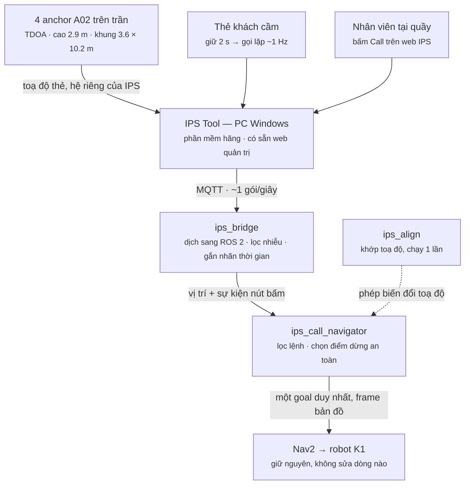

# Gọi robot bằng thẻ UWB

**Báo cáo giải pháp · Robotics VN · 28.08.2026**

> Khách cầm thẻ, giữ nút hai giây, robot tự tìm đến đúng chỗ họ đang ngồi — không cần bàn cố
> định, không cần ai chỉ đường cho robot.

| | |
|---|---|
| **± 0.28 m** | sai số vị trí thẻ khi người đi bộ (đo thực tế) |
| **4** | anchor UWB gắn trần, cao 2.9 m |
| **10** | thẻ đã cấu hình, 9 đang hoạt động |
| **1 phút** | hiệu chuẩn hệ toạ độ, bấm 2 điểm trên bản đồ |

---

## 1. Bài toán

Robot phục vụ trong nhà hàng hiện nay chỉ chạy được giữa những **điểm đã lập trình sẵn**: bàn số
5, quầy bar, cửa bếp. Khách đổi chỗ, kê thêm bàn ngoài sân, hay đơn giản là ngồi ở khoảng giữa
hai bàn — robot không biết đi đâu. Muốn gọi robot, khách phải bấm nút gắn cứng ở bàn, hoặc nhân
viên phải bấm hộ.

Giải pháp này đảo ngược quan hệ đó: **điểm đến không nằm trong bản đồ, mà nằm trong túi khách.**
Một chiếc thẻ UWB nhỏ bằng thẻ ngân hàng liên tục cho biết nó đang ở đâu trong nhà hàng với sai
số vài chục centimet. Khách giữ nút trên thẻ, robot nhận toạ độ đó, tự tính đường và đi tới.

Cùng một hạ tầng còn dùng được cho việc khác mà không phải lắp thêm gì: nhân viên gọi robot từ
máy tính quầy, quản lý xem realtime khách đang tập trung ở khu nào, hay cảnh báo khi thẻ ra khỏi
khu vực cho phép.

---

## 2. Hệ thống hoạt động thế nào

Bốn anchor gắn trên trần đo thời gian sóng UWB từ thẻ tới từng anchor (kỹ thuật TDOA) và suy ra
toạ độ. Phần mềm IPS Tool của hãng chạy trên một PC, gom toạ độ rồi đẩy ra ngoài qua MQTT. Từ đó
trở đi là phần chúng tôi xây dựng.



Toàn bộ phần thêm vào nằm trong ba node ROS 2. Nav2 và phần điều khiển robot không phải sửa gì —
hệ thống nối vào đúng một cửa: gửi cho Nav2 một điểm đến trong hệ toạ độ bản đồ. Hai nguồn phát
lệnh (thẻ của khách, web của nhân viên) đi chung một đường.

---

## 3. Một lệnh gọi diễn ra trong bảy bước

| # | Bước | Chi tiết |
|---|---|---|
| 01 | Khách giữ nút trên thẻ khoảng hai giây | Thẻ vào chế độ gọi và phát tín hiệu lặp lại mỗi giây cho tới khi được xác nhận |
| 02 | Hệ thống nhận diện đây là một lần bấm, không phải nhiều lần | Tín hiệu lặp được gom thành một phiên duy nhất. Không có bước này, mỗi giây robot sẽ nhận một lệnh mới và quay vòng tại chỗ |
| 03 | Kiểm tra chất lượng vị trí | Mẫu quá cũ, nhiễu quá lớn, hoặc chưa từng có vị trí của thẻ đó — lệnh bị từ chối kèm lý do cụ thể, không gửi điểm đến rác cho robot |
| 04 | Đổi toạ độ thẻ sang hệ toạ độ bản đồ của robot | Dùng phép biến đổi đã hiệu chuẩn sẵn một lần khi lắp đặt |
| 05 | Chọn điểm dừng, không phải chỗ người đứng | Lùi lại 0.9 m trên đường thẳng từ khách về phía robot, và quay mặt robot về phía khách khi tới nơi |
| 06 | Đối chiếu bản đồ chướng ngại vật | Nếu điểm dừng rơi vào tường, chân bàn hay vùng cấm, hệ thống dò xoắn ốc ra ngoài tới 1.5 m để tìm chỗ trống gần nhất |
| 07 | Gửi điểm đến cho Nav2 và báo lại cho thẻ | Thẻ rung nhẹ báo đã nhận lệnh, khách biết robot đang trên đường. Bấm huỷ giữa chừng thì robot dừng |

---

## 4. Ba vấn đề kỹ thuật phải giải

Ba việc dưới đây là toàn bộ khoảng cách giữa "có hệ định vị UWB" và "robot đến đúng chỗ khách".
Không việc nào trong đó là hiển nhiên, và cả ba đều đã chạy được.

### 4.1. Hai hệ toạ độ hoàn toàn xa lạ với nhau

Hệ định vị UWB có gốc toạ độ do người lắp anchor đặt ra. Bản đồ của robot có gốc do phần mềm SLAM
đặt tại chỗ robot bắt đầu quét. Hai hệ này lệch nhau một phép quay và một phép tịnh tiến — nói
"khách đang ở (0.5, −10.0)" thì robot không hiểu đó là chỗ nào trên bản đồ của nó.

```
   HỆ TOẠ ĐỘ UWB                              BẢN ĐỒ ROBOT
   ┌──────────────┐                     ┌──────────────────────────┐
   │ A4 ●──────● A3│                    │      ╱▔▔▔▔▔╲             │
   │   │        │  │   quay θ           │    ╱  ● ● ╲  ╲           │
   │   │        │  │  + dời (tx, ty)    │   │ ●     ●  │           │
   │   │        │  │  ───────────────►  │    ╲       ╱             │
   │ A1 ●──────● A2│  2 điểm bấm là đủ  │      ╲▁▁▁╱               │
   └──────────────┘                     │  mặt bằng robot tự quét  │
                                        └──────────────────────────┘
```

Hiệu chuẩn là việc đặt khung anchor lên đúng chỗ của nó trên mặt bằng. Người vận hành bấm chuột
vào chân hai anchor trên bản đồ; hai điểm xác định trọn vẹn phép quay và phép dời, hai anchor còn
lại tự hiện ra để kiểm chứng bằng mắt ngay lập tức.

Chúng tôi làm hai cách. Cách chính là **bấm hai điểm trên bản đồ**: người vận hành chỉ chuột vào
chân anchor A1 rồi A2, cả bốn anchor và khung bao hiện lên — đúng hay sai thấy ngay, sai thì kéo
chuột chỉnh lại rồi lưu. Mất khoảng một phút. Cách thứ hai, chính xác hơn nhưng lâu hơn, là gắn
một thẻ lên robot rồi lái tới vài điểm để hệ thống tự tính; cách này hấp thụ được cả sai lệch hệ
thống của UWB.

### 4.2. Nút bấm trên thẻ không phải một sự kiện

Đây là chỗ tài liệu của hãng không nói, và chỉ đo mới biết: giữ nút khoảng hai giây thì thẻ vào
"chế độ gọi" và **phát tín hiệu lặp lại mỗi giây**, không phải gửi một lần rồi thôi. Xử lý ngây
thơ sẽ cho ra một chuỗi lệnh chồng nhau: robot vừa tới nơi lại bị chính luồng tín hiệu đang chạy
gọi đi lần nữa.

Cách giải là coi mỗi lần bấm là một **phiên**: tín hiệu chỉ được tính là lệnh mới khi luồng cũ đã
ngắt hẳn ba giây. Các tín hiệu lặp ở giữa được hiểu đúng bản chất — là nhịp giữ, báo rằng khách
vẫn đang chờ.

Cũng bằng cách đo, chúng tôi phát hiện **nút Call trên web quản trị của hãng có phát tín hiệu ra
ngoài**, chỉ là dưới một dạng khác với tên gọi khác. Nhờ vậy nhân viên tại quầy gọi robot tới bàn
khách được mà không cần khách chạm vào thẻ — một tính năng không có trong kế hoạch ban đầu, có
được chỉ vì đã nghe kỹ đường truyền.

### 4.3. Vị trí một con người không phải là một điểm đến

Gửi thẳng toạ độ khách cho robot là sai ở ba điểm cùng lúc: robot sẽ cố đi vào đúng chỗ người
đang đứng; nó không biết quay mặt về hướng nào khi tới; và nếu khách ngồi sát tường thì điểm đó
nằm trong vùng cấm, Nav2 sẽ từ chối hoặc loay hoay.

```
                        ╭╌╌╌╌╌╮  dò vòng ra ngoài
                        ╎  ○  ╎  tới 1.5 m nếu bị chặn
   ◯╌╌╌╌╌╌╌╌╌╌╌╌╌╌╌╌╌╌╌╌╎──►──╎────────►  ●          ▓▓▓▓▓▓
   robot                ╰╌╌╌╌╌╯          khách       ▓ bàn ▓
                      điểm dừng   0.9 m  (vị trí thẻ) ▓ tường
                                         quay mặt về phía khách
```

Điểm đến được **tính** chứ không phải sao chép: lùi 0.9 m khỏi khách trên đường thẳng nối hai
bên, hướng robot quay về phía khách, và nếu ô đó không đi được thì dò xoắn ốc ra ngoài tìm chỗ
trống gần nhất. Khoảng cách 0.9 m cần được đặt lại theo bán kính thực tế của robot khi triển khai.

---

## 5. Số liệu đo trên hệ thật

Mọi con số dưới đây đo trực tiếp trên bộ thiết bị đang lắp, **không lấy từ catalogue của hãng**.
Chúng là cơ sở để đặt mọi ngưỡng trong phần mềm.

| Chỉ số | Giá trị đo | Ảnh hưởng tới thiết kế |
|---|---|---|
| Tần suất cập nhật vị trí thẻ | 1.006 Hz | Vị trí luôn trễ khoảng một giây; ngưỡng "mẫu quá cũ" phải đặt 3 s, không phải 1.5 s như dự kiến ban đầu |
| Sai số vị trí khi người đi bộ | 0.11 – 0.28 m | Ngưỡng loại mẫu xấu đặt ở 0.5 m; khoảng lùi 0.9 m đủ hấp thụ sai số này |
| Nhịp lặp của tín hiệu gọi | ~1 Hz | Bắt buộc phải gom thành phiên, ngắt 3 s mới tính lần bấm mới |
| Vùng phủ khung anchor | 3.6 × 10.2 m | Ngoài khung vẫn định vị được, sai số tăng dần — đã cho phép gọi từ ngoài khung |
| Độ cao lắp anchor | 2.9 m | Trên đầu người, tránh che khuất bởi thân người và đồ đạc |
| Pin thẻ sau đợt thử | 94 – 100 % | Chưa đủ dữ liệu về tuổi thọ pin thực tế — cần theo dõi dài ngày |
| Diện tích bản đồ robot | 27.6 × 30.2 m | Bản đồ rộng hơn vùng UWB; robot đi được cả chỗ không có phủ sóng |

---

## 6. Đã kiểm chứng tới đâu

Phần dưới phân biệt rạch ròi ba mức: chạy thật với phần cứng, chạy trên bàn với Nav2 mô phỏng, và
chưa chạy. Đây là mức trung thực cần thiết để quyết định bước tiếp theo.

| Mức | Nội dung |
|---|---|
| ✅ **Hệ thật** | Đọc được toạ độ 4 anchor và 10 thẻ từ phần mềm hãng; vị trí thẻ hiện realtime trên bản đồ robot |
| ✅ **Hệ thật** | Hiệu chuẩn hai hệ toạ độ bằng cách bấm hai điểm — bốn anchor nằm đúng bốn góc phòng trên bản đồ |
| ✅ **Hệ thật** | Nút bấm trên thẻ ra tới ROS, kèm vị trí khách tại đúng thời điểm bấm |
| ✅ **Hệ thật** | Nút gọi và nút huỷ trên web quản trị của hãng cũng ra tới ROS |
| 🔬 **Trên bàn** | Toàn bộ logic điều hướng: gom phiên, từ chối lệnh xấu, tính điểm dừng, dò chỗ trống khi bị chặn, huỷ giữa chừng, lệnh mới thay lệnh cũ. Kiểm thử với Nav2 mô phỏng, chín kịch bản, không lỗi |
| ⬜ **Chưa chạy** | Chuỗi đầy đủ trên robot thật: khách bấm nút và robot lăn bánh tới nơi. Đây là buổi thử tiếp theo |
| ⬜ **Chưa chạy** | Vận hành liên tục nhiều giờ với nhiều người gọi cùng lúc |

---

## 7. Giới hạn và rủi ro

Bốn điểm dưới đây cần được xử lý trước khi đưa vào chỗ có khách thật. Chúng không phải lỗi phần
mềm, mà là **ranh giới của giải pháp**.

> **⚠ Nút huỷ trên thẻ không phải thiết bị an toàn**
> Lệnh huỷ đi qua đường sóng UWB rồi qua phần mềm của hãng, có thể mất gói hoặc trễ. Robot đi tới
> chỗ có người, nên bắt buộc phải có nút dừng khẩn cấp phần cứng trên robot và cảm biến chống va
> chạm hoạt động độc lập với hệ thống này.

> **⚠ Bản đồ phải cố định thì hiệu chuẩn mới còn giá trị**
> Cấu hình hiện tại của robot dựng bản đồ mới mỗi lần khởi động, nghĩa là gốc toạ độ đổi và phép
> hiệu chuẩn hết hiệu lực. Trước khi triển khai phải chuyển sang chạy bản đồ đã lưu. Đây là thay
> đổi cấu hình, không phải viết thêm phần mềm.

> **Vị trí luôn trễ khoảng một giây**
> Khách đi bộ thì robot nhắm tới chỗ họ vừa rời khỏi. Với người đang ngồi ăn thì không thành vấn
> đề; với người vừa gọi vừa đi thì cần bật chế độ bám theo, hiện đã có nhưng chưa thử ngoài thực
> địa.

> **Nhiều người gọi cùng lúc chưa được xếp hàng**
> Hiện tại lệnh mới sẽ thay thế lệnh đang chạy. Trong nhà hàng đông khách, cần một hàng đợi có thứ
> tự và cách báo cho người sau biết còn bao lâu. Đây là phần việc tiếp theo, không lớn.

---

## 8. Triển khai cho một nhà hàng thật

**Khảo sát và lắp anchor.** Anchor gắn trần, cao khoảng 2.9 m, bao quanh khu vực cần độ chính xác
cao nhất. Vùng bên trong khung bốn anchor cho kết quả tốt nhất; ngoài khung vẫn dùng được với sai
số tăng dần, nên khu vực rìa như lối đi hay sân ngoài vẫn phủ được mà không cần thêm anchor.

**Quét bản đồ và hiệu chuẩn.** Robot tự quét mặt bằng một lần, lưu lại. Sau đó bấm hai điểm để
khớp hệ toạ độ — khoảng một phút. Chỉ làm lại khi quét bản đồ mới hoặc di chuyển anchor.

**Phát thẻ cho khách.** Mỗi bàn một thẻ, hoặc phát cho khách khi vào như thẻ giữ xe. Hệ thống hiện
có mười thẻ ba loại khác nhau; tất cả đều chỉ dùng một nút bấm nên khách không cần hướng dẫn.

**Nhân viên gọi hộ.** Từ máy tính quầy, nhân viên chọn thẻ của bàn cần phục vụ rồi bấm gọi — robot
đi tới đúng bàn đó. Dùng cho trường hợp khách không tiện thao tác, hoặc chủ động mang đồ ra.

Ba việc còn lại trước khi chạy thử có khách: chuyển robot sang dùng bản đồ đã lưu, thử chuỗi đầy
đủ trên robot thật, và bổ sung hàng đợi cho nhiều lệnh gọi đồng thời.

---

Số liệu đo trên hệ thống lắp đặt tại phòng thử nghiệm, tháng 8 năm 2026. Thiết bị định vị: anchor
Nooploop A02 và thẻ dòng T21/T22. Robot: nền tảng K1 chạy ROS 2 Humble với Nav2. Phần mềm tích hợp
gồm ba node ROS 2 và một package định nghĩa message, không sửa đổi phần điều hướng sẵn có của
robot.

**Tài liệu kỹ thuật đi kèm**: [NAV2_INTEGRATION.md](NAV2_INTEGRATION.md) — thiết kế chi tiết, tham
số, nhật ký thực hiện và toàn bộ kết quả kiểm thử.
